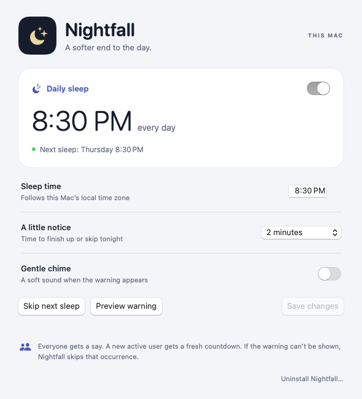

# Nightfall

A native menu bar app that gives everyone on this Mac a chance to finish up before its daily sleep.

The default is **sleep at 8:30 p.m. every day**, with a **two-minute countdown** starting around 8:28 p.m. An optional gentle chime is **off by default**; there are no spoken announcements. The countdown always gives the active user the full warning period, so a late presentation or user switch may delay sleep. In the warning, **Skip tonight** cancels that occurrence for the entire Mac. The settings and menu command **Skip next sleep** targets the next occurrence, including after today's scheduled time or across midnight. Later days stay scheduled. The time, warning length, and chime are configurable. Existing speech preferences migrate to sound off.

Nightfall puts the Mac to **sleep**. It does not power it off.



## Install

Requires **macOS 13 or later**. The published beta is for **Intel Macs**. Apple Silicon users can use a manual GitHub Actions build or build from source below; Apple Silicon hardware has not yet been tested.

The ready-made app archive is stored with **Git LFS**. This is an early beta; testing is ongoing.

1. Open [Nightfall-1.1.0-x86_64.zip](https://github.com/markdjwilliams/nightfall-mac/blob/3e8e31ed4308fede710e91dd00aae2ed36768139/Downloads/v1.1.0-beta.1/Nightfall-1.1.0-x86_64.zip), then choose **Download raw file**.
2. Unzip it, then open the extracted **Nightfall.app**.
3. Choose **Install for all users…** and authorize the standard macOS administrator prompt.
4. Nightfall reopens from Applications. Use the moon in the menu bar to open **Schedule & settings…**.

To update an existing installation, open the newly downloaded app and choose **Install this version…**. The installer keeps the shared schedule and skipped occurrences, then restarts Nightfall for signed-in users.

The beta is ad hoc signed, without Apple Developer ID signing or notarization. macOS may block a downloaded copy. A [SHA-256 checksum](https://github.com/markdjwilliams/nightfall-mac/blob/3e8e31ed4308fede710e91dd00aae2ed36768139/Downloads/v1.1.0-beta.1/Nightfall-1.1.0-x86_64.zip.sha256) is stored beside the archive.

GitHub's **Source code** downloads are for building Nightfall yourself. Use the app download above for the ready-made app. Git clones need [Git LFS](https://git-lfs.com/) installed to retrieve the archive; without it, the archive path contains a small pointer file. Building from source does not need Git LFS.

The installer adds one system service and one agent for every graphical login. It starts agents for users who are already signed in, as well as future logins. The schedule is shared by the whole Mac. An active desktop user may change it; any logged-in account can cancel an occurrence. If macOS disables Nightfall under **System Settings → General → Login Items & Extensions**, re-enable it or use **Repair installation…**.

**Preview warning** is harmless: it never sends a sleep request or consumes tonight’s schedule. The daily-sleep toggle takes effect when you choose **Save changes**. Pausing daily sleep keeps it off until someone enables it again.

## Courtesy and safety

- The countdown starts only after the active user’s app reports that its warning is visible and can receive input.
- A different active user gets a fresh, full countdown. Cancellation applies to everyone.
- A hidden, locked, switched-out, missing, or disconnected warning cannot approve sleep. Uncertain presentation is given a short grace period, then the occurrence is skipped. If you switch to another application during the warning, it loses input focus; the timer restarts if you return promptly, or skips after ten seconds.
- A service restart during a warning consumes the occurrence safely. A long pause or wake after a missed scheduled time does not cause immediate sleep. No timer wakes the Mac for this app.
- Processed calendar dates are saved before a power request, preventing repeated attempts after restart, clock rollback, or a cancelled warning. A failed sleep request is recorded and is not retried that day.
- Storage failures suspend power requests. No forced shutdown, private lock-screen API, Accessibility permission, or Screen Recording permission is used.

The service requests normal macOS system sleep using `IOPMSleepSystem`. A successful request does not guarantee hardware will sleep: macOS and device drivers retain control. The warning can protect interactive users, but does not detect the needs of unattended jobs or remote SSH users. Press **Skip tonight** or pause the schedule when those must continue.

## Build and verify

Requires macOS 13 or later and Apple Command Line Tools. No third-party packages are required. The build targets the current Mac’s processor; set `NIGHTFALL_ARCH=arm64` or `x86_64` to build for a different Mac.

Run these commands from the repository folder after cloning it or unpacking a source download:

```sh
./Scripts/build.sh
open build/Nightfall.app
```

The app is created locally in `build/`; it is not included in a source download. Opening it lets you install for all users as described above.

To run the automated checks:

```sh
./Tests/run-tests.sh
./Tests/run-model-tests.sh
python3 Tests/ServiceTests.py
python3 Tests/InstallerTests.py
python3 Tests/UninstallTests.py
./Scripts/check.sh
```

The first Swift build creates a local module cache and can take a few minutes. The build is ad-hoc signed for local use; it is not Developer ID signed or notarized for public distribution.

To build a downloadable app archive and checksum, run `./Scripts/package.sh`. It builds and checks the app, packages `Nightfall.app` at the root of the ZIP, then verifies a freshly extracted copy. Output is `build/Nightfall-<version>-<architecture>.zip` and its `.zip.sha256` checksum. Packaging does not install the app or trigger sleep.

## GitHub Actions builds

Open [Build Nightfall (manual)](https://github.com/markdjwilliams/nightfall-mac/actions/workflows/build.yml), choose **Run workflow**, and use the `main` branch. Leave **Also cross-build the Apple Silicon app** checked to get both processor versions. After a successful run, download **Nightfall-apps** from its **Artifacts** section. Unzip that download, then unzip the app archive for your Mac: `x86_64` for Intel or `arm64` for Apple Silicon. The app archives preserve executable permissions and signatures inside the outer Actions download.

The workflow runs scheduling and app-model tests, isolated installer/uninstaller tests and the Intel service tests with power actions disabled. By default, it builds and verifies both app archives on one standard Intel Mac runner. Apple Silicon is cross-built and signature-checked; this does not establish behavior on Apple Silicon hardware. Builds are ad hoc signed and are not notarized.

Builds are **manual only**. Pushes, pull requests, tags and schedules do not trigger builds. Each requested run uses one Mac runner with a **15-minute cutoff**; a new request cancels an older active run. Downloads expire after **seven days**. The checkout skips Git LFS downloads, and the workflow uses no caches, extra credentials, repository writes or automatic release publishing. Published app archives remain in Git LFS; Actions downloads are temporary build outputs.

Standard GitHub-hosted Actions runners are free for public repositories. Git LFS storage and bandwidth have separate quotas, including for public repositories. If running a private fork, check [Actions usage](https://github.com/settings/billing) before requesting builds: the included allowance is shared across your account, and the workflow cannot read your personal billing allowance. A hard **$0 Actions budget** prevents paid overage, but does not reserve included minutes. See GitHub's [Actions billing guidance](https://docs.github.com/en/billing/concepts/product-billing/github-actions), [Git LFS billing guidance](https://docs.github.com/en/billing/concepts/product-billing/git-lfs), and [budget controls](https://docs.github.com/en/billing/how-tos/set-up-budgets).

## Testing

Core tests cover scheduling, cancellation, presentation, multiple users, stale agents, restarts, wake gaps, daylight-saving changes, and clock changes. The service test uses the real socket and persistence with **power actions disabled**. It never sleeps the Mac. Installer and uninstaller tests use temporary files and simulated system services, including stop failures, upgrade rollback, and safe restart ordering; they do not alter the installed app.

For manual checks, use **Preview warning** first. Then verify a real countdown with the Mac in use, another signed-in user, user switching, full-screen apps, screen locking, and an app restart. Save work before allowing a real countdown to complete. These interactive conditions and actual hardware sleep need testing on the destination Mac; automated simulations cannot establish their behavior.

## Design

`Sources/NightfallCore` contains a deterministic Foundation scheduling state machine. `Sources/Nightfall` contains the AppKit/SwiftUI menu bar interface, per-user presentation, a root service, and a small authenticated local-socket protocol.

The daemon checks the current console UID independently and checks the socket client’s UID with `getpeereid`. Presentation acknowledgments are bound to the agent session and warning ID. Before sleeping, the service saves the consumed occurrence and checks the console user and heartbeat again. Its interface accepts a bounded set of schedule, status, and cancellation messages; it does not execute caller-supplied commands or paths.

Installed files:

| Location | Purpose |
| --- | --- |
| `/Applications/Nightfall.app` | Menu bar app and installer |
| `/Library/PrivilegedHelperTools/com.nightfall.mac.daemon` | Root-owned service executable, outside the group-writable Applications directory |
| `/Library/LaunchDaemons/com.nightfall.mac.daemon.plist` | System service registration |
| `/Library/LaunchAgents/com.nightfall.mac.agent.plist` | Courtesy agent in each Aqua login |
| `/Library/Application Support/Nightfall/` | Root-owned schedule, processed dates, and service log |
| `/var/run/com.nightfall.mac.sock` | Local IPC socket; no network service |

## Remove

Choose **Uninstall Nightfall…** in settings or the moon’s menu. Confirm removal for all users, then authorize the standard macOS administrator prompt. The uninstaller stops automatic sleep before removing the app and shared schedule, and closes each user’s menu bar agent.

Or remove it from Terminal:

```sh
sudo /Applications/Nightfall.app/Contents/Resources/uninstall.sh
```

This removes Nightfall’s app, services, and saved schedule. It leaves unrelated power-management settings alone.

## License and release status

Nightfall is a public beta licensed under [MIT](LICENSE). See [NOTICE.md](NOTICE.md) for Apple system-component notices. Testing began October 28, 2026, with a follow-up review planned for November 11. Public availability does not mean the two-week testing period is complete. See [RELEASE.md](RELEASE.md) for testing and distribution limitations.

Source: https://github.com/markdjwilliams/nightfall-mac
